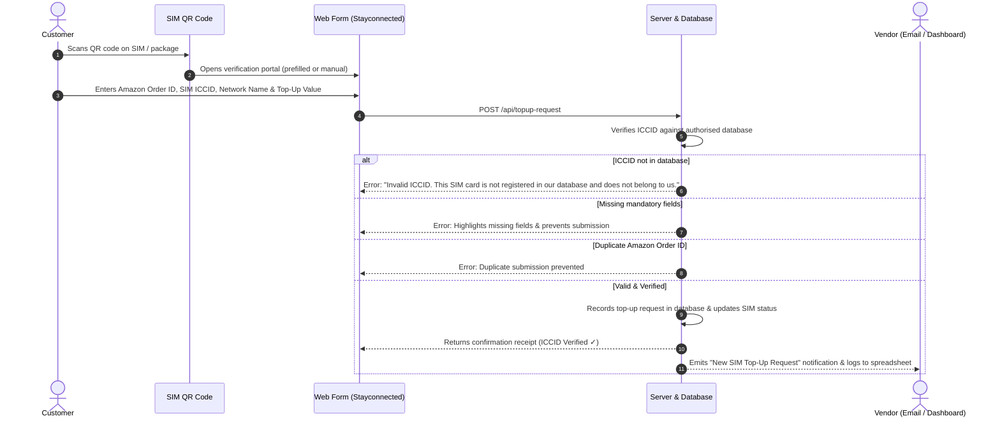

# Amazon SIM Card Verification & Top-Up Portal

This application provides a QR-code-based SIM verification and top-up request system tailored for Amazon SIM and E-Voucher sellers sending thousands of SIMs to Amazon customers.

The system ensures that customer requests are only processed after validating the SIM's ICCID on the server against your authorized database.

---

## 1. Customer Journey



---

## 2. Required Form Fields & Validation Rules

| Field | Requirement | Validation Rule |
|---|---|---|
| **Amazon Order ID** | **Mandatory** | Must match Amazon format `123-1234567-1234567`. Duplicate submissions of the same order ID are prevented. |
| **SIM card ICCID** | **Mandatory** | Checked strictly on the server against your database. If not found, displays: <br>_“Invalid ICCID. This SIM card is not registered in our database and does not belong to us.”_ |
| **Network Name** | **Mandatory** | Dropdown with major networks (`giffgaff`, `O2`, `Vodafone`, `EE`, `Three`, `Lebara`, etc.) or custom input. |
| **Top-Up Value** | **Mandatory** | Dropdown selection (`£5`, `£10`, `£15`, `£20`, `£25`, `£30`, `£40`, `£50`). |
| **Customer Email** | Optional | For email confirmation / customer communication. |

---

## 3. What You Will Receive

When a customer submits a valid request, you receive a notification structured as:

```text
New SIM Top-Up Request

Amazon Order ID: 123-1234567-1234567
SIM ICCID:       8944XXXXXXXXXXXXXXX
Network Name:    giffgaff
Top-Up Value:    £10
ICCID Verified:  Yes
Submitted At:    2026-10-14T22:00:00Z
```

### Stored in Database & Spreadsheet
All requests are automatically saved in:
- `data/topup-requests.json` (Real-time requests database)
- `data/activation-notifications.json` (Audit log)
- **1-Click Download:** Export all requests directly as a CSV spreadsheet from the Admin dashboard:
  `http://localhost:3000/api/admin/export-requests-csv`

---

## 4. Bulk Managing Thousands of SIMs

In the **Admin Dashboard** (`/admin.html`):
- **Upload CSV / Excel File:** Drag-and-drop or select a `.csv` spreadsheet containing thousands of 18–22 digit ICCIDs from your carrier/distributor.
- **Auto-Deduplication:** Duplicates are skipped automatically.
- **Export Inventory:** Export all registered SIMs with status and history to CSV.
- **Download Sample CSV:** Ready-made template available.

---

## 5. How to Run Locally

### 1-Click Launch (Windows)
Double-click:
```text
START_APP.bat
```
To stop the app:
```text
STOP_APP.bat
```

### Manual Launch
```powershell
npm run seed
npm start
```

### Links:
- **Customer Form:** [http://localhost:3000](http://localhost:3000)
- **Vendor Admin & Requests Feed:** [http://localhost:3000/admin.html](http://localhost:3000/admin.html)
- **Local Test Data & 1-Click Form Fill:** [http://localhost:3000/test-data.html](http://localhost:3000/test-data.html)

### Run Automated Verification Test:
```powershell
npm run test:local
```
